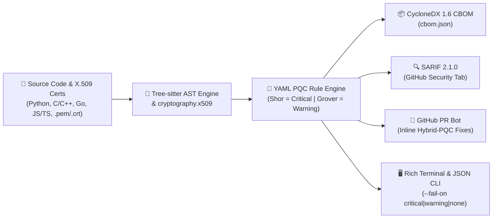

<div align="center">

# 🛡️ `cbom-guard`

**Automated Post-Quantum Cryptography (PQC) Code Scanner, CycloneDX 1.6 CBOM Generator, SARIF 2.1.0 Exporter & GitHub PR Remediation Bot**

[](LICENSE)
[](https://www.python.org/downloads/)
[](.github/workflows/ci.yml)
[](https://cyclonedx.org/)
[](https://sarifweb.oasis-open.org/)
[](action.yml)

*Ship quantum-ready software. Eliminate cryptographic blind spots before "Harvest Now, Decrypt Later" becomes a breach.*

</div>

---

## 🚨 Why `cbom-guard`? The Quantum Migration Imperative

**"Harvest Now, Decrypt Later"** is an active threat today. Adversaries are archiving encrypted traffic and sensitive artifacts now to decrypt them once cryptographically relevant quantum computers (CRQCs) arrive.

Global compliance mandates are locking in hard deadlines:

| Standard / Mandate | Scope | Key Deadline & Requirement |
| :--- | :--- | :--- |
| 🇺🇸 **NIST PQC (FIPS 203, 204, 205)** | Global / US Federal | Standardized **ML-KEM** (Kyber), **ML-DSA** (Dilithium), and **SLH-DSA** (SPHINCS+) to replace RSA, ECC, DSA, and DH. |
| 🛡️ **NSA CNSA 2.0** | National Security & Critical Infra | Requires AES-256, SHA-384/512, ML-KEM-1024, and ML-DSA-87 across software and networking by **2030**. |
| 🇪🇺 **EU PQC Roadmap** | EU Member States & NIS2 | Mandates cryptographic inventory via **Cryptographic Bills of Materials (CBOM)** and immediate hybrid PQC migration planning. |

### Why Tree-sitter AST Beats Regex Scanners

| Capability | Legacy Regex Scanners | 🛡️ `cbom-guard` (Tree-sitter AST) |
| :--- | :--- | :--- |
| Ignores comments, docstrings & log strings | ❌ High false-positive noise | ✅ Concrete Syntax Tree (CST) node filtering |
| Resolves import aliases (`import rsa as r`) | ❌ Misses aliased calls | ✅ Per-file symbol table resolution |
| Evaluates key sizes (`key_size < 2048`) | ❌ Fragile multi-line matching | ✅ Structured argument constraint engine |
| Inspects X.509 `.pem`/`.crt`/`.cer`/`.der` | ❌ Not supported | ✅ Native `cryptography.x509` inspection |
| Outputs schema-valid CycloneDX 1.6 CBOM | ❌ Custom JSON only | ✅ Official `JsonStrictValidator` verified |

---

## ⚙️ How It Works



---

## ⚡ Quickstart

### Install

```bash
pip install cbom-guard
# or with uv:
uv tool install cbom-guard
```

### Scan a Repository

```bash
# Interactive terminal table + CycloneDX 1.6 CBOM + SARIF 2.1.0 + HTML Dashboard
cbom-guard scan ./src \
  --cbom-out cbom.json \
  --sarif-out cbom-guard.sarif \
  --html-out pqc-report.html \
  --fail-on critical

# Machine-readable JSON output for CI pipelines
cbom-guard scan ./src --json --quiet --fail-on none
```

### List All Loaded Detection Rules

```bash
cbom-guard list-rules
```

---

## 🧩 Interactive Reference

<details>
<summary>🚀 <strong>5-Line GitHub Action Workflow</strong> (CBOM Artifacts + Security Tab + Inline PR Comments)</summary>

```yaml
name: PQC Readiness
on: [push, pull_request]

permissions:
  contents: read
  security-events: write
  pull-requests: write

jobs:
  cbom-guard:
    runs-on: ubuntu-latest
    steps:
      - uses: actions/checkout@v4
      - uses: CoraxCoLAB/cbom-guard@v0.1.0
        with:
          fail-on: critical
```

</details>

<details>
<summary>📦 <strong>Sample CycloneDX 1.6 CBOM Output</strong> (<code>cbom.json</code>)</summary>

```json
{
  "bomFormat": "CycloneDX",
  "specVersion": "1.6",
  "components": [
    {
      "bom-ref": "cbom-asset-1-PY-CRYPTO-001",
      "type": "cryptographic-asset",
      "name": "RSA-2048",
      "cryptoProperties": {
        "assetType": "algorithm",
        "algorithmProperties": {
          "primitive": "pke",
          "parameterSetIdentifier": "2048",
          "cryptoFunctions": ["keygen"],
          "classicalSecurityLevel": 112,
          "nistQuantumSecurityLevel": 0
        }
      },
      "evidence": {
        "occurrences": [
          {
            "location": "src/auth/keys.py",
            "line": 18,
            "offset": 15,
            "symbol": "cryptography.hazmat.primitives.asymmetric.rsa.generate_private_key"
          }
        ]
      }
    }
  ]
}
```

</details>

<details>
<summary>📋 <strong>Supported Languages, Libraries & PQC Rule Matrix (36 Built-in Rules)</strong></summary>

| Language / Artifact | Libraries & Standards Covered | Quantum Threats Detected |
| :--- | :--- | :--- |
| **Python** (19 rules) | `cryptography`, `hashlib`, `PyCryptodome` (`Crypto.*`/`Cryptodome.*`), `ssl`, `rsa`, `ecdsa` | Shor (RSA, RSA `< 2048`, ECDSA/ECC, DSA, DH, Ed25519/X25519, TLS 1.0/1.1), Grover (3DES, DES, RC4, MD5, SHA-1, PBKDF2-SHA1), Safe (`AES-256-GCM`) |
| **C / C++** (8 rules) | OpenSSL (`<openssl/evp.h>`, `<openssl/rsa.h>`, `<openssl/ec.h>`, `<openssl/des.h>`), `libsodium` (`<sodium.h>`) | Shor (`EVP_RSA_gen`, `RSA_generate_key_ex`, `EVP_EC_gen`, `EC_KEY_generate_key`, `crypto_box_keypair`, `crypto_sign_keypair`, `crypto_scalarmult`), Grover (`EVP_md5`, `EVP_sha1`, `EVP_des_ede3_cbc`, `EVP_rc4`), Safe (`EVP_aes_256_gcm`) |
| **Go** (5 rules) | `crypto/rsa`, `crypto/ecdsa`, `crypto/ecdh`, `crypto/ed25519`, `crypto/md5`, `crypto/sha1`, `crypto/des`, `crypto/rc4` | Shor (RSA, ECDSA, ECDH, Ed25519), Grover (MD5, SHA-1, DES, 3DES, RC4) |
| **JavaScript / TypeScript** (4 rules) | `node:crypto` / `crypto`, `jsonwebtoken` | Shor (`generateKeyPair`/`generateKeyPairSync` RSA/EC/DSA, JWT `RS256`/`ES256`/`PS256`), Grover (`createHash` MD5/SHA-1, `createCipheriv` DES/3DES/RC4) |
| **X.509 Certificates** | `.pem`, `.crt`, `.cer`, `.der` via `cryptography.x509` | Shor (RSA, ECDSA, DSA, Ed25519, Ed448 public keys), Weak signature hashes (MD5, SHA-1), Expiration tracking |

</details>

---

## 📚 Documentation

- [User Manual](docs/USER_MANUAL.md)
- [Architecture Overview](docs/ARCHITECTURE.md)
- [Rule Authoring Guide](docs/RULE_AUTHORING_GUIDE.md)
- [GitHub Action Guide](docs/GITHUB_ACTION_GUIDE.md)
- [Implementation Plan](IMPLEMENTATION_PLAN.md)
- [Changelog](CHANGELOG.md) | [Contributing](CONTRIBUTING.md) | [Security Policy](SECURITY.md)

---

## 🏆 Creators & Credits

`cbom-guard` is engineered and maintained by:

- **Organization:** [**Corax CoLAB**](https://coraxcolab.com) — *Deep Tech, Edge AI & Quantum Security Engineering*
- **Lead Developer:** **Pelle Nyberg** ([GitHub: `@PelleNybe`](https://github.com/PelleNybe))

---

## 📄 License

Distributed under the [MIT License](LICENSE).
